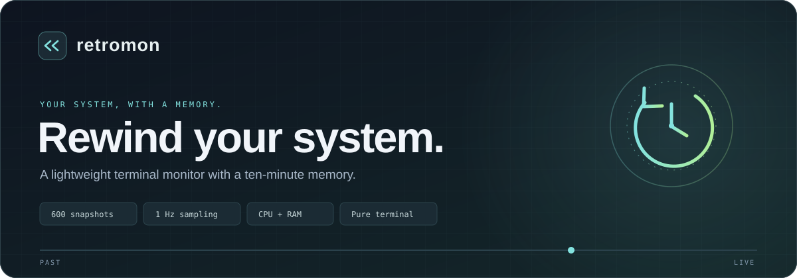
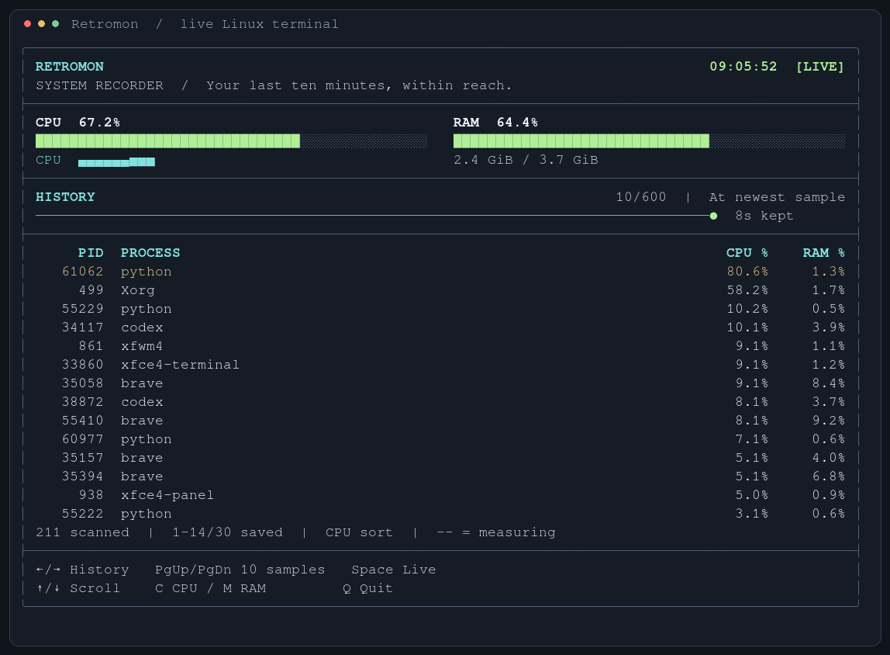
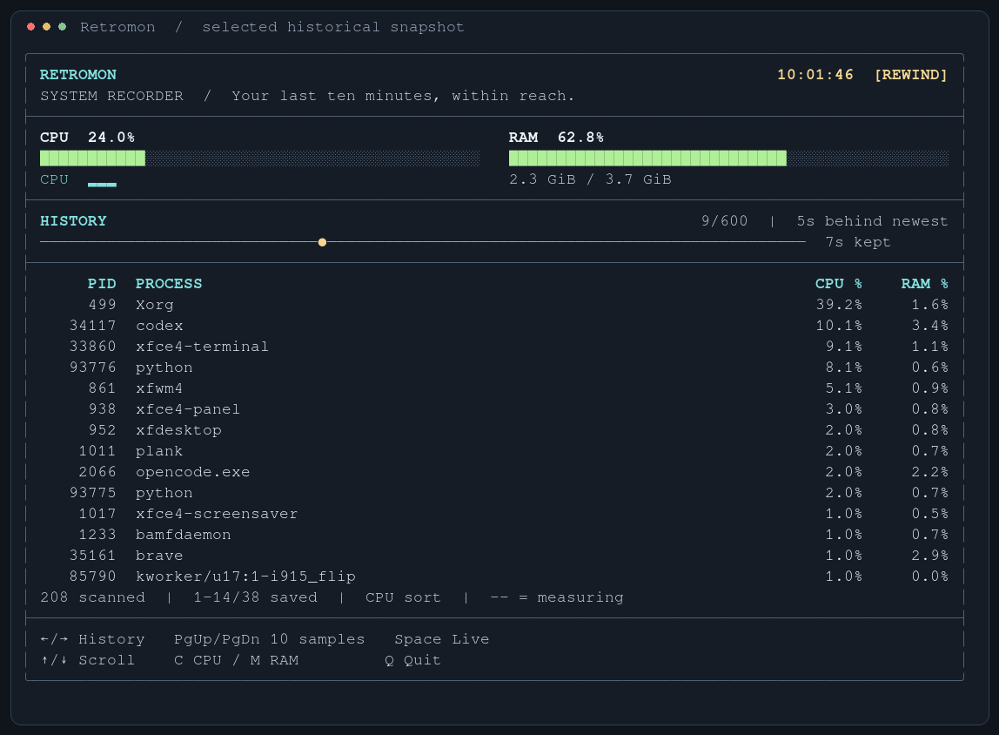
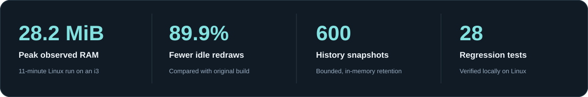
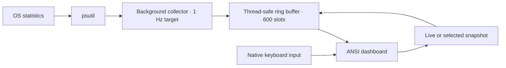

<div align="center">
<a name="readme-top"></a>



# Retromon

**Look back at the spike you just missed.**

A lightweight terminal system monitor with CPU/RAM rewind.<br/>
Record recent activity, revisit a timestamp, and inspect the processes behind it.

[**Get started**](#quick-start) · [**Features**](#features) · [**Benchmarks**](#benchmarks) · [**Documentation**](#documentation) · [**Report an issue**][issues-link]

[![Python 3.10 or later][python-badge]](pyproject.toml)
[![MIT license][license-badge]](LICENSE)
[![Runtime dependency: psutil][runtime-badge]](pyproject.toml)
[![GitHub stars][stars-badge]][stars-link]

</div>

<br/>

<div align="center">



<sub>Actual terminal output. CPU/RAM meters, recorded history, and sortable process leaders.</sub>

</div>

<details>
<summary><strong>Explore the README</strong></summary>

- [Why Retromon](#why-retromon)
- [Features](#features)
- [Quick start](#quick-start)
- [Keyboard controls](#keyboard-controls)
- [Benchmarks](#benchmarks)
- [Platform support](#platform-support)
- [How it works](#how-it-works)
- [Documentation](#documentation)
- [Development](#development)
- [FAQ](#faq)
- [Contributing](#contributing)
- [License](#license)

</details>

## Why Retromon

Your computer slows down. You open a monitor. The spike has already passed.

Retromon keeps recent CPU and RAM activity in memory while you work. Move backward through recorded snapshots to inspect what was happening, then jump straight back to live view.

**Run it before an incident. Keep the evidence within reach.**

## Features

<table>
  <tr>
    <td width="50%" valign="top">
      <strong>Rewind to a recorded moment</strong><br/>
      Browse approximately ten minutes of history. Your selected snapshot stays fixed while new samples arrive.
    </td>
    <td width="50%" valign="top">
      <strong>Follow CPU and RAM leaders</strong><br/>
      Retain the top 20 processes by each metric, deduplicated into up to 40 records. Switch sorting with one key.
    </td>
  </tr>
  <tr>
    <td width="50%" valign="top">
      <strong>Stay inside your terminal</strong><br/>
      Read meters, a history track, and a process table in an adaptive dashboard built with Python and psutil.
    </td>
    <td width="50%" valign="top">
      <strong>Keep recording while you investigate</strong><br/>
      Independent background sampling continues during rewind. Collection errors and stale readings are visible.
    </td>
  </tr>
</table>

### 01 · Rewind to the moment

Press <kbd>←</kbd> or <kbd>H</kbd> to inspect an earlier sample. The timestamp and recorded values remain selected as the collector continues running. Press <kbd>Space</kbd> to return to live monitoring.



Snapshots include real timestamps. Navigation moves by **recorded sample**, rather than assuming each sample is exactly one second apart. When a selected snapshot leaves the buffer, Retromon shows an explicit notice and moves to the oldest retained sample.

### 02 · Inspect both CPU and RAM leaders

A memory-heavy process can be quiet on CPU. Retromon preserves leaders from both metrics: the **top 20 by CPU** and **top 20 by RAM**, with overlapping processes counted once.

Press <kbd>C</kbd> for CPU sorting or <kbd>M</kbd> for RAM sorting. Use <kbd>↑</kbd> and <kbd>↓</kbd> to scroll through the saved records. Up to **40 unique processes** are retained per snapshot; overlap, unavailable readings, or process exits can reduce that count.

### 03 · A dashboard that fits

A **100 × 32** terminal shows the full dashboard, including a recent CPU sparkline. **80 × 24** uses a compact layout. Below **44 × 18**, recording continues while a resize message appears.

Use `--no-color` for monochrome output or `--ascii` for simpler borders and charts. `NO_COLOR` is respected, and non-UTF-8 consoles automatically use ASCII characters.

### 04 · Visible state, reliable history

Initial CPU readings show `--` until a baseline exists. Unavailable names and permissions are handled without stopping the collector; exited or reused process IDs are checked before retention. Collection failures appear on screen and are retried, and delayed updates are marked stale.

The history buffer retains **600 snapshots** and overwrites its oldest entries as it fills. This bounds retained history instead of accumulating an ever-growing log.

<div align="right">

[Back to top](#readme-top)

</div>

## Quick start

Requires **Python 3.10+** and an interactive terminal with ANSI cursor support.

<details open>
<summary><strong>Linux / macOS</strong></summary>

```bash
git clone https://github.com/Arman-Khan-24/Retromon.git
cd Retromon
python3 -m venv .venv
source .venv/bin/activate
python -m pip install .
retromon
```

</details>

<details>
<summary><strong>Windows · PowerShell</strong></summary>

```powershell
git clone https://github.com/Arman-Khan-24/Retromon.git
cd Retromon
py -3 -m venv .venv
.\.venv\Scripts\python.exe -m pip install .
.\.venv\Scripts\retromon.exe
```

Use `python` instead of `py -3` if the Python launcher is unavailable. After installation, `run.bat` also launches the app and uses the local virtual environment when present.

</details>

Already have psutil installed? Run `python app.py` from the repository directory.

```bash
retromon --no-color
retromon --ascii
retromon --help
```

A dark terminal theme works best with the colored dashboard. Use `--no-color` with a light theme or your own terminal palette.

## Keyboard controls

| Key | Action |
| :--- | :--- |
| <kbd>←</kbd> / <kbd>→</kbd> or <kbd>H</kbd> / <kbd>L</kbd> | Previous / next recorded sample |
| <kbd>Page Up</kbd> / <kbd>Page Down</kbd> | Move ten samples backward / forward |
| <kbd>Space</kbd> | Resume live view |
| <kbd>↑</kbd> / <kbd>↓</kbd> | Scroll the saved process table |
| <kbd>C</kbd> / <kbd>M</kbd> | Sort by CPU / RAM |
| <kbd>Q</kbd> or <kbd>Ctrl+C</kbd> | Quit and restore the terminal |

## Benchmarks

[](docs/BENCHMARK.md)

Measured on **14 November 2026** using an **Intel i3-4005U**, four logical threads, **3.74 GiB usable RAM**, Linux, Python 3.14.9, and psutil 7.2.2. The actual app ran for **eleven minutes** in a 100 × 32 pseudo-terminal with colors enabled.

| Metric | Original build | Updated build |
| :--- | ---: | ---: |
| Peak observed RAM, including Python and psutil | 21.6 MiB | **28.2 MiB** |
| Mean app CPU, one logical core = 100% | 6.32% | **6.22%** |
| Full-screen redraws per second in idle live view | 9.91 | **1.00** |
| Maximum retained process records per snapshot | 20 CPU leaders | **Up to 40 CPU/RAM leaders** |

The updated run reached **600 retained snapshots**. During the following minute, observed RAM stayed between **28.168 and 28.188 MiB**. Additional memory preserves both CPU and RAM leaders and their timestamp/identity metadata.

> [!NOTE]
> The **89.9% reduction applies to idle redraws**, not total CPU usage. CPU overhead stayed close to the original. These are observations from one comparison on a shared host; memory grows while history fills and can fluctuate with process churn or system conditions.

[Read the methodology](docs/BENCHMARK.md) · [View raw results](docs/benchmark-results.json) · [View sampling measurements](docs/sampling-results.json)

<div align="right">

[Back to top](#readme-top)

</div>

## Platform support

Native keyboard handling is implemented for **Windows, Linux, and macOS**. Verification status is kept separate from implementation:

| Platform | Native input path | Runtime verification |
| :--- | :--- | :--- |
| Windows | `msvcrt` | Native console verification pending |
| Linux | `select`, `termios`, `tty` | **28 local tests passed**, including real terminal interaction |
| macOS | `select`, `termios`, `tty` | Native terminal verification pending |

A GitHub Actions workflow is configured for **Python 3.10 and 3.13 on all three platforms**. Hosted jobs have not been run in this session. The Windows suite skips POSIX pseudo-terminal tests.

## How it works



| Component | Responsibility |
| :--- | :--- |
| [`DataCollector`](app.py) | Sample CPU/RAM, retain leaders from both metrics, and check process identity |
| [`SystemSnapshot`](app.py) | Store sampled values, timestamps, process records, and sequence IDs |
| [`RingBuffer`](app.py) | Append and overwrite snapshots under a lock; preserve stable historical selection |
| [`KeyReader`](app.py) | Decode queued keyboard bytes and time out incomplete escape sequences |
| [`terminal_ui.py`](terminal_ui.py) | Render the dashboard according to terminal size and selected view |

**One runtime dependency: psutil.** History lives in the app's memory and is discarded when the app exits.

## Documentation

| Resource | What's inside |
| :--- | :--- |
| [Benchmark report](docs/BENCHMARK.md) | Environment, methods, comparison, collector latency, and limitations |
| [Raw benchmark results](docs/benchmark-results.json) | Measured RAM, CPU, redraws, startup times, and source hashes |
| [Sampling results](docs/sampling-results.json) | Collector timing observations and host-workload variation |
| [Regression tests](tests) | History, sampling, input, rendering, failure recovery, and terminal behavior |
| [License](LICENSE) | MIT license and attribution |

## Development

Install the project in editable mode inside your virtual environment:

```bash
python -m pip install -e .
python -m unittest discover -s tests -v
```

Reproduce measurements:

```bash
# Linux/macOS: fills history, then observes another minute after rollover
python tools/benchmark.py --duration 660 --output docs/benchmark-local.json

# Collector-only timing; does not require an interactive terminal
python tools/sampling_benchmark.py --samples 60 --output docs/sampling-local.json
```

The app uses Python's standard library for threading, timing, input, and rendering. Keep runtime dependencies small and changes covered by relevant regression tests.

## FAQ

<details>
<summary><strong>Can I inspect activity from before I started Retromon?</strong></summary>

No. Retromon must be running before the incident. It records into memory during that session; history does not survive exit.

</details>

<details>
<summary><strong>Does it record every process or every spike?</strong></summary>

The collector samples running processes, then retains CPU and RAM leaders. Rewind shows only those recorded leaders. Brief spikes or short-lived processes between samples may be missed, and sampling can be delayed under load.

</details>

<details>
<summary><strong>Does the ring buffer mean RAM is constant from startup?</strong></summary>

Retained history is bounded by 600 snapshots with up to 40 process records each. RAM grows while the buffer fills. Total process memory also includes Python, psutil's active-process cache, temporary sampling data, and allocator overhead, so it is not a fixed byte count.

</details>

<details>
<summary><strong>Why can a process show more than 100% CPU?</strong></summary>

Per-process CPU percentages follow psutil's convention: one logical core represents 100%. A multithreaded process can use more than one core. Global CPU usage uses a system-wide percentage.

</details>

<details>
<summary><strong>Can Retromon terminate a process?</strong></summary>

No. Retromon is an observation tool; it does not kill processes or modify their settings.

</details>

## Contributing

Bug reports, improvements, and documentation fixes are welcome. For larger changes, [open an issue][issues-link] first to discuss the scope.

Useful contributions include native Windows/macOS verification, clearer terminal layouts, and reproducible performance measurements. Include the OS, Python version, terminal, and reproduction steps when reporting a problem.

[**Report a bug**][issues-link] · [**Open a pull request**][pulls-link]

## License

[MIT](LICENSE) · Copyright © 2026 [Arman Khan][author-link].

<div align="center">

**Keep a little history. Find the moment that mattered.**

[Get started](#quick-start) · [Explore the source][repo-link] · [Back to top](#readme-top)

<sub>README presentation inspired by <a href="https://github.com/lobehub/lobehub#readme">LobeHub</a>.</sub>

</div>

<!-- Links -->

[repo-link]: https://github.com/Arman-Khan-24/Retromon
[issues-link]: https://github.com/Arman-Khan-24/Retromon/issues
[pulls-link]: https://github.com/Arman-Khan-24/Retromon/pulls
[stars-link]: https://github.com/Arman-Khan-24/Retromon/stargazers
[author-link]: https://github.com/Arman-Khan-24
[python-badge]: https://img.shields.io/badge/Python-3.10%2B-83e2df?style=flat-square&labelColor=151c26&logo=python&logoColor=white
[license-badge]: https://img.shields.io/badge/License-MIT-b0ef98?style=flat-square&labelColor=151c26
[runtime-badge]: https://img.shields.io/badge/Runtime-psutil-83e2df?style=flat-square&labelColor=151c26
[stars-badge]: https://img.shields.io/github/stars/Arman-Khan-24/Retromon?style=flat-square&label=Stars&color=83e2df&labelColor=151c26
